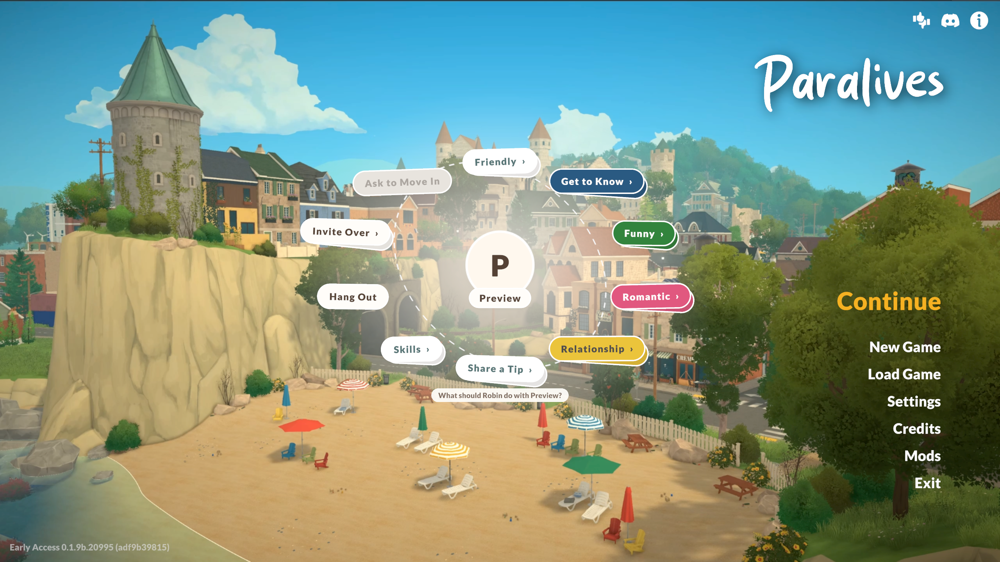

# ParaPie: Sims-style pie menus for Paralives

ParaPie replaces the Together Card system with a classic life-sim pie menu. You don't wait for a bar to fill: click another Para and pick a social whenever you like, and relationships build from it. It keeps the Paralives look: category pastel colours, the game's own font, cream sticker-style pills, soft shadows and bouncy animations.



## Download
- **Steam Workshop:** [ParaPie - Sims-style Pie Menu](https://steamcommunity.com/sharedfiles/filedetails/?id=3838767700). Subscribe, then run `Install-ParaPie.bat` once from the item's `Install` folder; the Workshop page has the steps.
- **Manual:** download `ParaPie-<version>.zip` from [Releases](../../releases), and copy everything in it into your Paralives folder (Steam > right-click Paralives > Manage > Browse local files).

This is a code mod. It ships with the BepInEx 5 mod loader, which the installer and the zip set up for you.

## How it plays
- **Click another Para.** A pie opens at the mouse with their portrait in the middle.
- **Social slices** (shown when your Paras are hanging out together): Friendly, Get to Know, Funny, Romantic, Mean… Each opens a ring with **every social your Para qualifies for** with that Para. Success chance shows as a badge, and hovering shows trait info.
- **Interaction slices** (sand-coloured): the Para's normal interactions such as Hang Out and Invite Over, including submenus. Greyed slices explain why they're unavailable when you hover.
- **Not hanging out yet?** The pie shows the normal interactions only. Start a hangout and the socials appear.
- **Picking a social** runs the game's own card logic, aimed at the Para you clicked. The success wheel, outcomes, relationship changes, memories and cooldowns all work as in the base game.
- **The together bar is gone.** Clicking anywhere outside the pie closes it. `‹ Back` and `More…` slices handle submenus and long lists.

## Keys
| Keys | Action |
|---|---|
| Ctrl+F7 | Turn the whole mod on/off (back to cards and bar) at any time |
| Ctrl+F8 | Show a sample pie (to check the look in Live mode) |
| Ctrl+F9 | Unstick: if the game ever seems stuck paused after a social, this closes card mode and any open menu |

## Settings
`Paralives/BepInEx/config/com.parapie.paralives.piemenu.cfg` (edit it with the game closed):
- `ClickParaForSocialPie`: the click-a-Para pie (default on)
- `HideTogetherBar`: remove the bar (default on). If you turn it off, the bar still works and its card hand also opens as a pie.
- `ShowAllSocials`: list every eligible social (default on), or set false for a random hand like the cards
- `GroupIntoCategoriesAbove`: with more socials than this, they are grouped into categories
- `MenuScale`, `OpenAtMouse`, `PlayfulTilt`: look and feel
- `Text` section: the few English strings the mod adds

## Known limits
- The NPC-initiative and Storyteller cards appeared when the bar opened. With the bar hidden they don't come up. Set `HideTogetherBar = false` to keep them.
- Socials need the two Paras to be in the same hangout, because that's how Paralives tracks a conversation.
- Card "variants" are not offered separately in the social pie.
- Clicking objects still uses the original Paralives list.

## Install / uninstall
Requires **BepInEx 5.4.23.2 x64**.
- Mod file: `Paralives/BepInEx/plugins/ParaPie/ParaPie.dll`
- To remove only the mod, delete the `BepInEx/plugins/ParaPie` folder.
- To remove all mod loading, also delete `winhttp.dll`, `doorstop_config.ini`, `.doorstop_version` and the `BepInEx` folder from the Paralives folder.

The mod also writes its own log, `BepInEx/ParaPie.log`, which survives a force-close. It also has a watchdog: if the game ever sits paused in card mode with nothing to click for 4 seconds, it recovers on its own and writes what happened to `BepInEx/ParaPie.log`.

If a Paralives update breaks something, the mod logs the error to `BepInEx/LogOutput.log` and switches back to the original UI rather than breaking the game.

## Building
Needs the game installed with BepInEx 5, Git Bash, and the Roslyn compiler from the [Microsoft.Net.Compilers.Toolset](https://www.nuget.org/packages/Microsoft.Net.Compilers.Toolset) NuGet package (`tasks/net472/csc.exe`).

```bash
CSC=/path/to/csc.exe ./build.sh --install
```

This compiles `src/*.cs` against the game's own assemblies and copies the DLL into the plugins folder. `DEFINE=PARAPIE_DEV` adds the developer tools: a self-test, an automated playtest that loads your latest save and plays socials, and a one-shot Workshop uploader. Each one only runs when its flag file exists in `BepInEx/config`.

`workshop/Install` holds the Workshop installer and uninstaller scripts. Copy the BepInEx files and `ParaPie.dll` into `workshop/Install/Files` to rebuild the Workshop item.

## How it works (for modders)
- **Social pie** (`SocialPie.cs`): postfix on `UIInteractions.Show`. The game builds its interaction list as usual, hidden with a disabled nested `Canvas`, and the pie mirrors its items and calls their own `OnListItemClicked`. Socials come from `TogetherManager.PickCharacterCards` with `ShowAllAvailableCards` switched on only for that call, filtered to cards that can target the clicked Para.
- **Playing a social:** the group is dealt just that card, `UICharacters.SetTogetherCardsMode` runs, and then the hidden card is clicked. If it needs a target, `OnCharacterSelection(clickedPara)` is called. Everything after that is the game's own code.
- **Together bar:** prefix on `UICharactersTogetherBar.Update` hides and collapses it.
- **Together-mode pie** (`PieModel.cs`): if the game deals a hand itself, the hidden `UITogetherCard`s are shown as slices.
